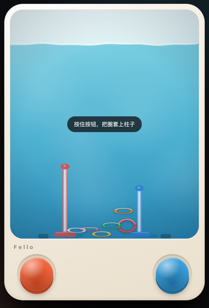

### Products

<table>
<tr>
<td align="center" valign="middle" width="280"> <b>Fello</b> 自带 API Key 的角色对话工作台</td>
<td align="center" valign="middle" width="280"> <b>Folio</b> 英语四六级与雅思真题精读精听</td>
<td align="center" valign="middle" width="280"> <b>TweakDen</b> 小红书发帖前合规检测与标题改写</td>
</tr>
</table>

**CupNote** — 咖啡记录小票与个人咖啡墙

Next.js · React · TypeScript · Prisma · PostgreSQL

### Open source

<table>
<tr>
<td align="center" valign="middle"></td>
<td align="center" valign="middle"></td>
</tr>
<tr>
<td align="center"><b>Loops</b> — 童年水压套圈机的网页复刻 <a href="https://github.com/minov9/loops">minov9/loops</a> · MIT</td>
<td align="center"><b>MinoCV</b> — 免费在线简历生成器，20+ 主题，按职位描述 AI 优化 <a href="https://github.com/minov9/minocv">minov9/minocv</a> · MIT</td>
</tr>
</table>
