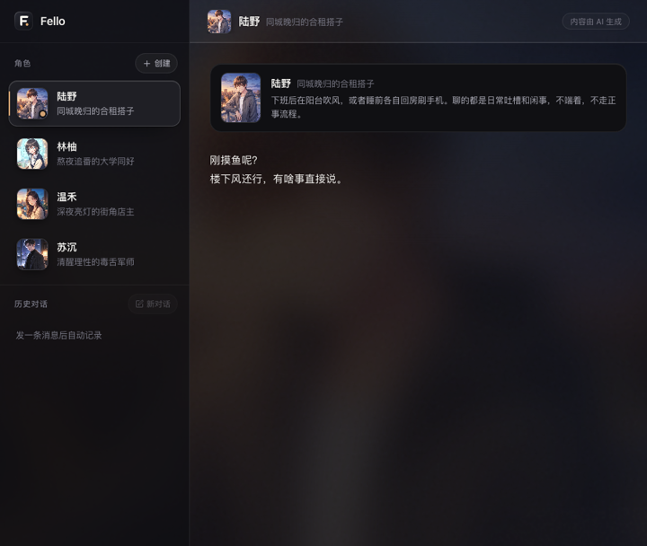
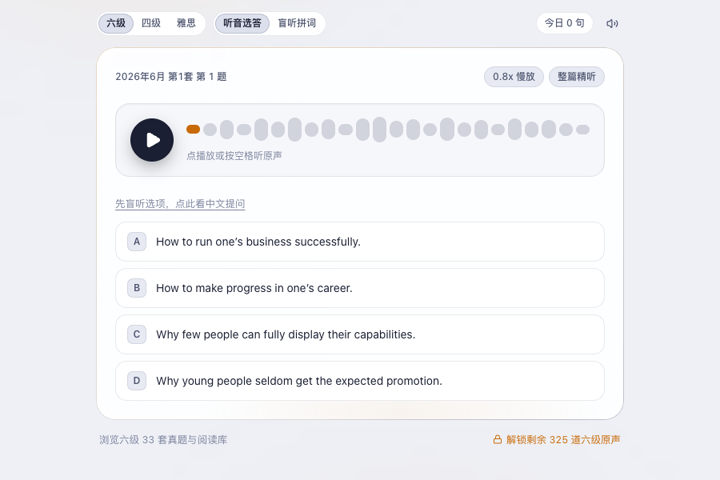
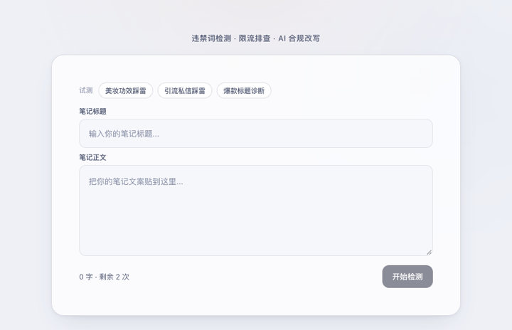
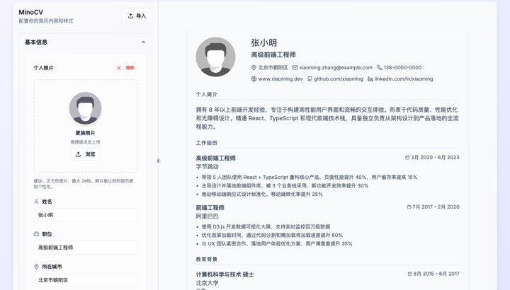

### Products

| | | |
|---|---|---|
|  |  |  |
| **Fello** 自带 API Key 的角色对话工作台 | **Folio** 英语四六级与雅思真题精读精听 | **TweakDen** 小红书发帖前合规检测与标题改写 |

**CupNote** — 咖啡记录小票与个人咖啡墙

Next.js · React · TypeScript · Prisma · PostgreSQL

### Open source

| | |
|---|---|
|  |  |
| **Loops** — 童年水压套圈机的网页复刻 [minov9/loops](https://github.com/minov9/loops) · MIT | **MinoCV** — 免费在线简历生成器，20+ 主题，按职位描述 AI 优化 [minov9/minocv](https://github.com/minov9/minocv) · MIT |
